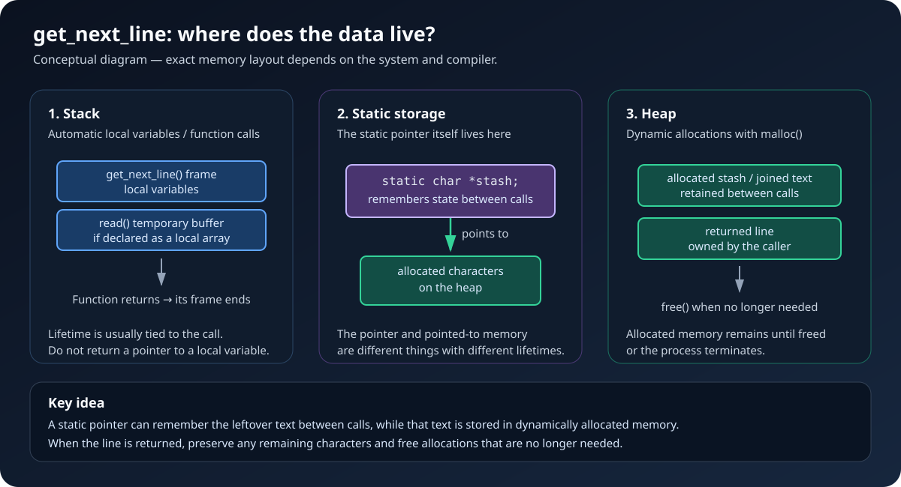

# get_next_line

## Introduction

This project was developed in 2024 at 1337 Coding School, part of the 42 Network. It was an important step in my C programming journey because it pushed me to understand memory management more deeply.

I decided to share this project on GitHub to document what I learned and help other students understand the ideas behind reading files line by line in C.

## Project Overview

The goal of `get_next_line` is to write a function that reads from a file descriptor and returns one line per function call. Repeated calls continue reading from where the previous call stopped, until there is no more input or an error occurs.

A line normally includes its terminating newline character (`\n`) when one is present. The final line can be returned without a newline if the file ends that way. When there is no line left to return, the function returns `NULL`.

The function is commonly declared as:

```c
char *get_next_line(int fd);
```

The project also introduced a configurable `BUFFER_SIZE`, which determines how many bytes are requested in each `read()` call. A line can be longer than the buffer, so the function must keep reading and joining data until it has a complete line or reaches the end of the file.

## Example

```c
#include <fcntl.h>
#include <stdio.h>
#include <stdlib.h>
#include <unistd.h>
#include "get_next_line.h"

int main(void)
{
    int fd = open("example.txt", O_RDONLY);
    char *line;

    if (fd < 0)
        return (1);
    while ((line = get_next_line(fd)) != NULL)
    {
        printf("%s", line);
        free(line);
    }
    close(fd);
    return (0);
}
```

Each call returns a newly allocated line in common implementations of this project, so the caller must free the returned string after using it. The exact permitted functions and implementation details depend on the version of the subject used by your campus.

## What I Learned

### 1. Memory Management

This project taught me more about dynamic memory management. A line can be larger than `BUFFER_SIZE`, so I had to think carefully about how to allocate enough space, join the data read so far with newly read bytes, extract a line, preserve the leftover characters, and release memory that was no longer needed.

I learned to:

- Check whether an allocation succeeded before using the returned pointer.
- Keep track of which function owns each allocated block of memory.
- Free temporary buffers and intermediate strings when they are no longer needed.
- Avoid memory leaks, invalid reads and writes, use-after-free errors, and double-free errors.
- Handle edge cases such as empty files, long lines, and a final line without a newline.

### 2. Static Variables

One of the key concepts in `get_next_line` is the use of a `static` variable to preserve data between function calls.

A normal local variable is created for a function call and its lifetime ends when that call returns. A local static variable retains its value between calls. This is useful because `read()` may fetch more data than is needed for the current line. The unused characters must be kept so the next call can continue from the correct position.

A simplified example is:

```c
char *get_next_line(int fd)
{
    static char *stash;

    /* Read more data, return one line, and preserve the leftover text. */
}
```

Here, `stash` remembers the leftover text between calls. The `static` keyword controls the lifetime of the pointer variable; it does **not** automatically allocate the character buffer on the heap. In a typical implementation, `stash` may point to a buffer created with `malloc()`.

### 3. Understanding the Stack and the Heap

I also learned how the stack and heap differ and why the distinction matters when writing C programs.




**The stack** is commonly used for function-call information and automatic local variables. Its memory is managed automatically as functions are called and return. For example:

```c
void example(void)
{
    int count = 0; /* automatic local variable */
}
```

When `example()` returns, the lifetime of `count` ends. You should not return a pointer to a local variable whose lifetime has ended.

**The heap** is used for dynamic allocations. Functions such as `malloc()` request memory that remains allocated until it is released with `free()` or the process ends. In `get_next_line`, this is useful for storing strings whose sizes can vary depending on the input.

```c
char *line = malloc(size);

if (line == NULL)
    return (NULL);
/* Use the allocated memory. */
free(line);
```

The example is illustrative; real code must ensure that `size` is correct and that the memory is freed exactly once when it is no longer needed.

**An important distinction:** the pointer `stash` in the example above has static storage duration, while the dynamically allocated text it points to may live on the heap. The pointer and the memory it points to are separate objects.

### 4. File Descriptors and `read()`

I learned how file descriptors identify an input source, such as a file or standard input, and how `read()` retrieves a limited number of bytes at a time.

Because `read()` does not necessarily return a complete line in one call, `get_next_line` must inspect the bytes it receives, detect newline characters, and continue reading when the line is incomplete. It must also handle the end of the file and errors correctly.

### 5. String Manipulation

The project gave me more practice working with C strings and character buffers. I had to locate newline characters, calculate string lengths, concatenate chunks, extract a line, and preserve any remaining characters for the next call.

These operations reinforced how important null terminators, buffer sizes, pointer ownership, and allocation sizes are when manipulating strings in C.

## Challenges

The main challenge was preserving unread data between calls without losing characters or leaving allocated memory behind. I also had to account for lines longer than the buffer, empty files, end-of-file behavior, read errors, and the correct cleanup of temporary allocations.

Working through these cases helped me become more careful about the lifetime of data and the responsibility that comes with dynamic allocation in C.

## Conclusion

`get_next_line` was a valuable project because it took the memory-management concepts I had started learning in Libft and made me apply them to a more stateful problem.

I gained a better understanding of dynamic allocation, `free()`, static variables, the stack and heap, file descriptors, and string manipulation. Most importantly, I learned that good C code is not only about getting the expected output; it is also about managing memory safely and preserving the correct state between function calls.
